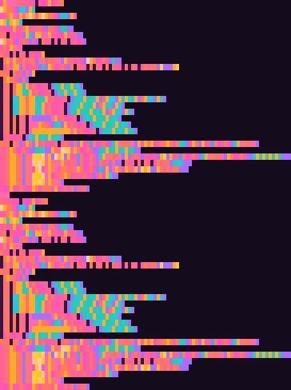

# selfportrait

A Python program that paints its own source code into a PNG. Every
character becomes one small colored block, one line of code becomes one
row of blocks. Read the pixels back and you get the exact program that
drew them, byte for byte. Run that, and it draws the same PNG again.

## Run it

Needs only Python 3 (standard library).

    python3 selfportrait.py > selfportrait.png   # paint
    python3 unpaint.py selfportrait.png          # read the code back out
    python3 unpaint.py selfportrait.png | python3 - > again.png
    cmp selfportrait.png again.png               # no output: identical

    sh check.sh                                  # the full test

`build.py` regenerates `selfportrait.py` from a template if you want to
change the program.

## How it works

The trick is that the palette index of each pixel is the character's own
byte value. The PNG is an 8-bit palette image, so its 256 color slots
line up with the 256 byte values: slot 105 is `i`, slot 61 is `=`, and
so on. Nothing is encoded or compressed by hand; the pixel data is
literally the source text, each byte repeated into a 4x8 block, with
index 0 as padding at the end of short lines. The palette then decides
how that text looks: lowercase letters fade from coral to pink, digits
are teal, capitals gold, brackets violet, quotes pink, operators orange,
everything else blue, and spaces a dark plum.

To read it back, `unpaint.py` takes one pixel from each block, strips
the padding, and joins the rows with newlines. A `tEXt` chunk named
`scale` records the block size.

The program knows its own source the usual quine way. The file is a
string `s` holding the program body, followed by the same body as
code:

    s='''<body>'''
    <body>

The body rebuilds the whole file as `"s='''" + s + "'''\n" + s`. That is
why the picture looks like the same block of code painted twice: the top
half is the string, the bottom half is what runs. The body avoids
backslashes and triple quotes so the two copies stay identical.

PNG itself is written by hand: signature, `IHDR`, `PLTE`, `tEXt`,
`IDAT` (zlib) and `IEND`, each with its CRC32.

## Files

- `selfportrait.py`: the program (2101 bytes, 61 lines).
- `selfportrait.png`: what it draws (364x488 pixels, 3806 bytes).
- `unpaint.py`: reads the program back out of the PNG.
- `body.txt`: the program body, the part that appears twice.
- `build.py`: writes `selfportrait.py` from `body.txt`.
- `check.sh`: decodes the PNG with a second, stricter decoder (all five
  PNG filters, CRCs, every block must be one solid color), checks the
  fixed point, and makes sure three sabotaged copies fail.

## Limits

Output is byte-identical only as long as `zlib.compress` produces the
same stream, which holds for one zlib version but is not promised
across versions. The decoded source still matches either way. ASCII
source only. The image has only been checked by decoders, not judged
by eye, so how readable the painted code looks is unconfirmed.

MIT License. Copyright (c) 2026 goblincouncil.
